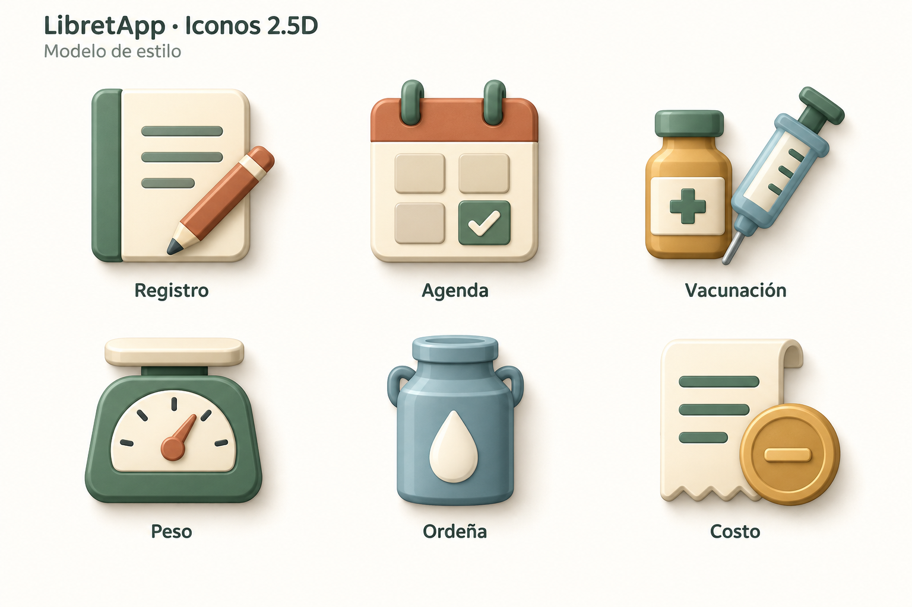

# Modelo de iconos 2.5D — segunda propuesta

Estado: referencia aprobada y aplicada al catálogo de producción. Creada el 13
de septiembre de 2026 mediante la herramienta integrada de generación de
imágenes. A partir de ella se generaron 64 maestros PNG independientes y sus
WEBP de 256×256.

## Dirección visual

Iconos frontales con relieve bajo, bordes redondeados y superficies satinadas.
La profundidad debe distinguirse por el espesor de cada pieza, los paneles
hundidos o elevados y las sombras de contacto entre piezas. Los reflejos
siguen los bordes de cada objeto y quedan contenidos en sus superficies.

- Luz suave desde arriba a la izquierda, consistente en toda la familia.
- Laterales inferiores y derechos algo más oscuros para expresar espesor.
- Dos o tres piezas principales por icono; detalles secundarios limitados.
- Siluetas reconocibles y peso visual equilibrado entre conceptos.
- Verde salvia, terracota, ocre, crema y azul apagado como paleta principal.
- Acabado mate o satinado, sin texturas fotográficas ni brillo de vidrio.

| Referencia de color | Base |
| --- | --- |
| Verde salvia | `#547663` |
| Verde oscuro | `#345848` |
| Terracota | `#C66B45` |
| Ocre | `#DAA54A` |
| Crema | `#FFF5DF` |
| Azul apagado | `#7E9DA2` |

## Los seis ejemplos

| Concepto | Forma principal | Detalle de relieve |
| --- | --- | --- |
| Registro | Libreta y lápiz | Lomo, borde del papel y lápiz superpuesto |
| Agenda | Calendario | Anillas y casillas elevadas |
| Vacunación | Frasco y jeringa | Tapa, etiqueta y piezas superpuestas |
| Peso | Báscula | Carcasa, plataforma y dial encajado |
| Ordeña | Recipiente de leche | Cuello, asas y gota elevada |
| Costo | Recibo y moneda | Papel curvado y borde de moneda |

Registro y Agenda son muestras conceptuales de estilo. Sus símbolos no
añaden automáticamente nuevos recursos ni reemplazan la navegación inferior.
El catálogo inicial mantiene sus 64 iconos: Cultivos (8), Salud (8), Inventario
y Finanzas (8), Registro (17), Estados (13) y Tareas (10). La segunda fase
añade 53 iconos de Ubicaciones: 46 tipos concretos y 7 categorías. Los 13
animales se conservan sin cambios.

## Aplicación al catálogo

Cada icono se creó como recurso individual y conserva las rutas vigentes. El
fondo crema y los rótulos pertenecen solamente a la lámina modelo; los recursos
de la app tienen transparencia real, sin rótulos ni fondos rectangulares.

Las láminas `catalogo-64-claro.png`, `catalogo-64-oscuro.png` y
`catalogo-64-24px.png` documentan el catálogo inicial. Las láminas
`ubicaciones-53-claro.png`, `ubicaciones-53-oscuro.png` y
`ubicaciones-53-24px.png` documentan la segunda fase.

El prompt exacto de esta propuesta se conserva en [PROMPT.md](PROMPT.md).
